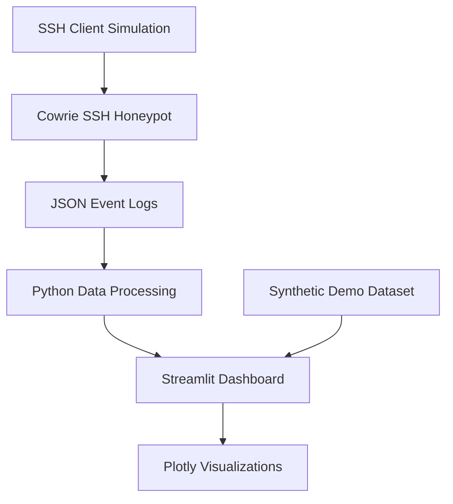

# 🛡 Cowrie Honeypot — Threat Analytics Dashboard

A cybersecurity project built using Python, Cowrie SSH Honeypot, Streamlit, Pandas and Plotly to analyze SSH honeypot events and visualize suspicious activity.

## 🚀 Live Demo

**[Open the Live Dashboard](https://cowrie-honeypot-dashboard-yp5hzty5bzmqbekegbkyyz.streamlit.app/)**

The public dashboard uses synthetic sample data for demonstration. It does not display live attacks.

## ✨ Features

- SSH event monitoring and analysis
- Failed and successful login statistics
- Attack activity timeline
- Event type distribution
- Most targeted usernames
- Command activity analysis
- SSH session investigation
- Interactive event and IP filters
- CSV investigation report export

## 🧰 Technology Stack

| Technology | Purpose |
|---|---|
| Python | Data processing |
| Cowrie | SSH honeypot |
| Streamlit | Dashboard interface |
| Pandas | Log analysis |
| Plotly | Interactive charts |
| Kali Linux | Development environment |

## 🏗 Architecture



The local environment uses Cowrie logs. The public deployment uses a separate synthetic dataset.

## 📊 Dashboard Metrics

The dashboard displays:

- Total events
- Failed login attempts
- Successful logins
- Unique source IP addresses
- Event timeline
- Command activity
- Session summaries

## ⚙️ Run Locally

Clone the repository:

```bash
git clone https://github.com/faizan69-don/cowrie-honeypot-dashboard.git
cd cowrie-honeypot-dashboard
```

Install dependencies:

```bash
pip install -r requirements.txt
```

Run the demonstration dashboard:

```bash
COWRIE_DEMO_MODE=true streamlit run app.py
```

## 🔐 Security and Privacy

- No real Cowrie logs are included in the public repository.
- No attempted passwords are included in the dashboard dataset.
- The sample IP addresses are reserved documentation addresses.
- The public deployment uses synthetic data only.
- The project is intended for authorized cybersecurity learning and defensive analysis.

## 🎯 Project Objective

To gain practical experience with SSH honeypots, Linux, Python-based security event analysis, and interactive threat visualization.
