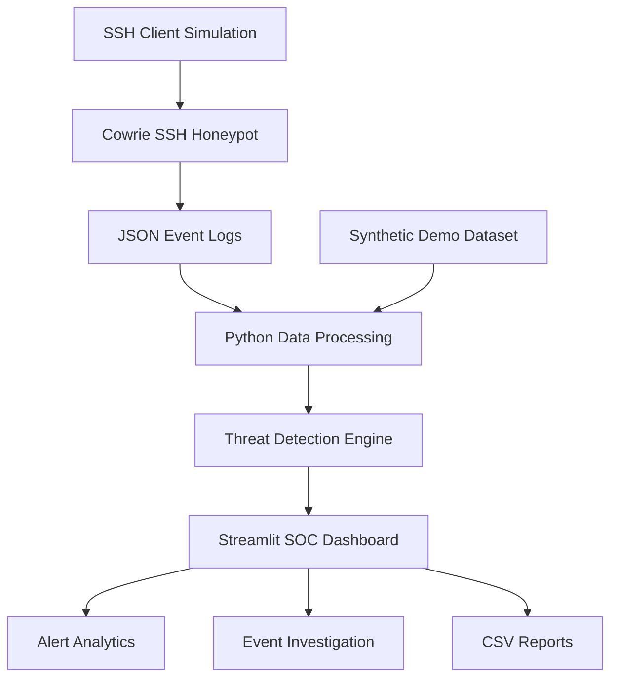
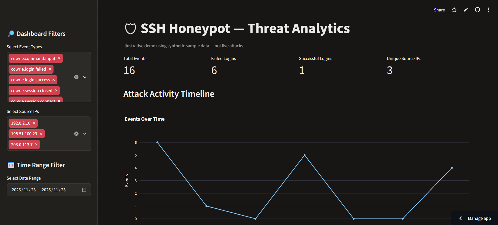

# 🛡 Cowrie Honeypot — Threat Analytics Dashboard

A cybersecurity project built using Python, Cowrie SSH Honeypot, Streamlit, Pandas and Plotly to analyze SSH honeypot events, detect suspicious activity and visualize security alerts through an interactive SOC-style dashboard.

## 🚀 Live Demo

**[Open the Live Dashboard](https://cowrie-honeypot-dashboard-yp5hzty5bzmqbekegbkyyz.streamlit.app/)**

The public dashboard uses synthetic sample data for demonstration. It does not display live attacks.

## ✨ Features

### SSH Honeypot Monitoring
- Cowrie SSH honeypot integration
- SSH login event monitoring
- Failed and successful login statistics
- SSH session investigation
- Command activity analysis

### Threat Detection Engine
- Repeated failed login detection
- Successful login monitoring
- Reconnaissance activity detection
- Sensitive file access attempt detection
- Suspicious download activity detection
- Permission modification attempt detection
- Privilege escalation attempt detection
- Network utility activity detection

### SOC Analytics Dashboard
- Alert severity metrics
- Alert distribution by detection category
- Severity distribution chart
- Top alert source IP analysis
- Interactive severity and detection filters
- Alert investigation table
- CSV alert report export
- Event investigation report export

Detection rules are heuristic indicators of suspicious activity, not proof of compromise.

## 🧰 Technology Stack

| Technology | Purpose |
|---|---|
| Python | Application logic and threat detection |
| Cowrie | SSH honeypot |
| Streamlit | Interactive dashboard |
| Pandas | Event processing and analysis |
| Plotly | Interactive visualizations |
| Kali Linux | Development and testing environment |
| Git & GitHub | Version control |
| Streamlit Community Cloud | Public demo deployment |

## 🏗 Architecture



The local environment processes Cowrie JSON logs. The public deployment uses a separate synthetic dataset.

## 🚨 Threat Detection

The project uses Python-based rule-driven heuristics to identify suspicious SSH activity.

Examples include:

- Multiple failed login attempts from a source IP.
- Commands used for system reconnaissance.
- Attempts to access sensitive system files.
- Download utilities such as `wget` and `curl`.
- Permission modification commands such as `chmod`.
- Privilege-related commands such as `sudo`.
- Network utilities such as `nc`.

Alerts are assigned severity levels to help organize investigation priorities.

## 📊 Dashboard Metrics

The dashboard displays:

- Total SSH events
- Failed login attempts
- Successful logins
- Unique source IP addresses
- Event timeline
- Event type distribution
- Targeted usernames
- Command activity
- SSH session summaries
- Threat detection alerts
- Alert severity distribution
- Top alert sources

## ⚙️ Run Locally

Clone the repository:

```bash
git clone https://github.com/faizan69-don/cowrie-honeypot-dashboard.git
cd cowrie-honeypot-dashboard
```

Create and activate a virtual environment:

```bash
python -m venv .venv
source .venv/bin/activate
```

Install dependencies:

```bash
pip install -r requirements.txt
```

Run the demonstration dashboard:

```bash
COWRIE_DEMO_MODE=true streamlit run app.py
```

Open the local URL displayed by Streamlit in your browser.

For local Cowrie log analysis, configure Cowrie separately and use demo mode disabled. The application expects the JSON log at:

```text
var/log/cowrie/cowrie.json
```

## 🔐 Security and Privacy

- No real Cowrie logs are included in the public repository.
- The public dashboard uses synthetic sample data.
- Sample IP addresses use reserved documentation ranges.
- Password fields are excluded from the dashboard's selected data columns.
- Sensitive logs and credential files are excluded through Git ignore rules.
- The project is intended for authorized cybersecurity learning and defensive analysis.

Note: Local Cowrie logs should remain private because honeypot logs may contain captured credentials and attacker activity.

## 📸 Dashboard Preview



The dashboard above displays illustrative synthetic sample data.

## 🎯 Project Objective

To gain practical experience with SSH honeypots, Linux administration, Python-based security event analysis, rule-based threat detection and interactive SOC dashboard development.

## 👨‍💻 Author

**Mohammed Faizan Qureshi**

GitHub: [faizan69-don](https://github.com/faizan69-don)
